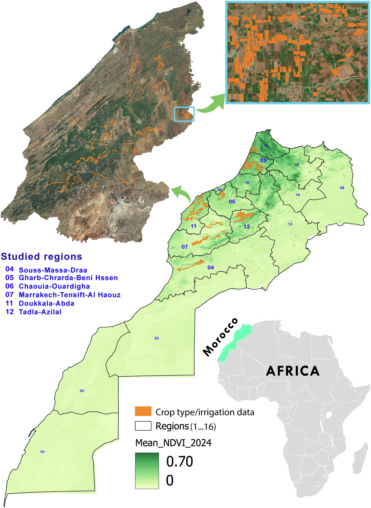
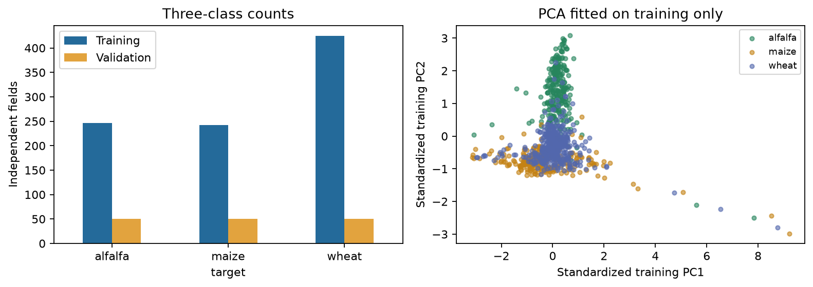
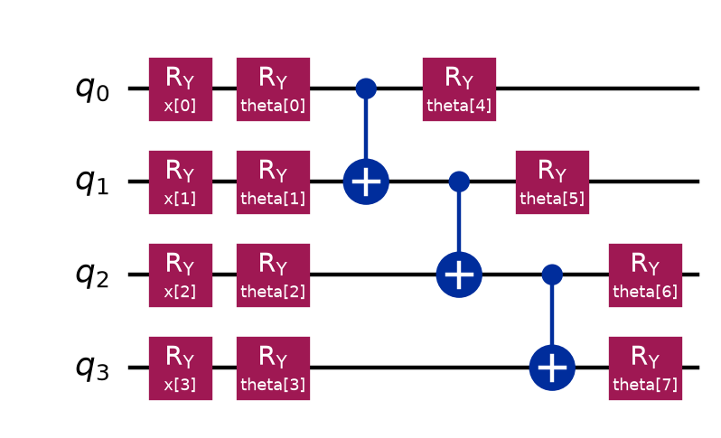
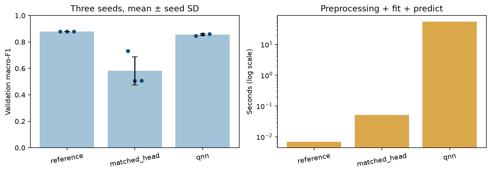

<p>
  
  &nbsp;&nbsp;&nbsp;&nbsp;
  
</p>

# Moroccan Crop Classification Challenge

**Qiskit Fall Fest · EMSI · Quantum Africa**

Build a quantum or hybrid model to classify **alfalfa, maize and wheat** from satellite features. You receive **914 training, 150 validation and 221 unlabeled test fields**. Start with the [student brief (PDF)](Student_Challenge_Brief.pdf), then work through [the notebook](notebooks/Qiskit_QuantumAfrica_Crop_Challenge.ipynb).

The simple starter QNN performs worse than the classical baseline. Your task is to improve the approach **or replace it with another quantum or hybrid model**. You do not have to extend this QNN. A well-supported comparison can earn full analysis credit even if it does not beat the baseline.

## Install and run

Clone the repository, then create a Python 3.12 environment:

```bash
git clone https://github.com/walid-mk/QiskitFallFest_EMSI_QuantumAfrica.git
cd QiskitFallFest_EMSI_QuantumAfrica
python3.12 -m venv .venv
.venv/bin/python -m pip install -r requirements.txt
.venv/bin/python -m ipykernel install --user --name crop-challenge --display-name "Crop challenge"
```

The notebook includes saved outputs for viewing directly on GitHub. To reproduce them, open `notebooks/Qiskit_QuantumAfrica_Crop_Challenge.ipynb` in a notebook editor, select **Crop challenge**, and run all cells. The pinned environment uses Qiskit 2.4.2 and Qiskit Machine Learning 0.9.1. All data is included; local simulation needs no IBM token. To execute and export without an editor:

```bash
.venv/bin/python -m jupyter nbconvert --to html --execute notebooks/Qiskit_QuantumAfrica_Crop_Challenge.ipynb --output-dir outputs
```

The default fit uses 100 fixed training fields. Set `USE_FULL_TRAINING = True` for the main 914-field comparison. Later plots read saved full-training results, so changing the quick fit does not replace those plots. Your generated files go in `outputs/`.

## Dataset in context

Ouassanouan et al. (2026) describe around **10,000 surveyed agricultural parcels** across Morocco, with crop and irrigation labels and associated satellite observations. This challenge uses a prepared **three-crop cohort from Doukkala**, with fixed training, validation and test splits. Read the [dataset paper](https://www.nature.com/articles/s41597-026-06993-y) for the wider collection methodology.

<p align="center">
  <a href="https://www.nature.com/articles/s41597-026-06993-y/figures/1">
    
  </a>
</p>

**Image source:** Figure 1 in Ouassanouan, Y., Elfarkh, J., Grich, S., Liblab, A. & Chehbouni, A., *Crop and irrigation types ground-truth dataset for Moroccan agricultural regions*, **Scientific Data 13, 746 (2026)**. [Original figure](https://www.nature.com/articles/s41597-026-06993-y/figures/1) · [DOI](https://doi.org/10.1038/s41597-026-06993-y). © The Author(s) 2026, reproduced unchanged under [CC BY-NC-ND 4.0](https://creativecommons.org/licenses/by-nc-nd/4.0/). The map describes the source dataset's coverage, not the challenge splits.

## Inside the starter

<p align="center">
  
</p>

**Explore the data:** training classes are imbalanced; validation contains 50 fields per crop. PCA provides a compact feature view, fitted only on training data.

<p align="center">
  
</p>

**Understand the model:** four prepared features enter through RY gates, followed by eight trainable angles and three CX gates. The notebook explains the three-class readout and where you can change or replace this model.

## Starting results

Validation results using all 914 training fields and seeds 0, 1 and 2:

| Model | Mean macro-F1 | Mean accuracy |
| --- | ---: | ---: |
| Classical baseline: RBF SVM | 0.8797 | 88.00% |
| Simple four-qubit QNN | 0.8557 | 85.56% |
| Small classical replacement control | 0.5814 | 65.11% |

<p align="center">
  
</p>

**Read the comparison:** dots show seeds 0/1/2, error bars show seed standard deviation, and runtime uses a logarithmic scale. Timings depend on the machine. All three starter figures above are generated by the notebook from the supplied data and saved validation runs.

The SVM is deterministic. The QNN has eight trainable angles; the control has eleven parameters, a disclosed 37.5% mismatch. Saved predictions, histories and scores are in `results/`. Keep them as reference results and save your own runs separately. These results do not demonstrate a quantum advantage.

## Where to work

- **Notebook:** explains each step and output, with a table mapping every Python file to the changes you can make.
- **`challenge/models.py`:** encoding, QNN and classical control; **`challenge/submission.py`:** your final model's `fit`/`predict` interface.
- **`challenge/coverage.py`:** reproducible training-size comparisons; see [coverage commands](docs/COVERAGE.md).
- **`data/`:** supplied tables and PCA views; read [feature definitions and limitations](data/README.md). Keep these files unchanged.
- **`configs/`:** baseline configuration and recorded starter settings. `reference.json` is loaded by the baseline; `pilot.json` records settings and is not an automatic configuration loader.

Fit transformations on training data only. Use validation data for model selection and test data only for final predictions. “Development data” in the original brief means validation data. Keep all three classes and the supplied spatial splits; IDs are never model inputs. Larger datasets require a supplied, checked extension: adding rows alone cannot guarantee better accuracy.

## Submit

Submit one runnable notebook or code package with configurations and results, plus **three to five slides**. Run selected stochastic models and controls with seeds **0, 1 and 2**. Report macro-F1, accuracy, each class's precision/recall, confusion matrices, runtime and model resources.

Judging: predictive performance **30**, experimental quality and analysis **40**, model design and reproducibility **30**. Optional verified IBM inference may earn **+5**. See the [evaluation guide](docs/EVALUATION.md) and [method ideas](docs/HINTS.md).

Use exact local simulation with at most **eight qubits**. Plan for up to **15 minutes per starter seed** and **35 minutes per final seed**, including preprocessing and prediction; final judging-machine details will be announced. **Submission deadline, timezone and route: to be announced.**

Hardware inference is optional and disabled by default. Only that section needs `requirements-hardware.txt`, credentials in your environment and permission to use the chosen account/backend. Train locally first.

## Data source

Adapted from Ouassanouan et al., [Moroccan Crop and Irrigation Dataset v2](https://doi.org/10.6084/m9.figshare.28486022.v2), under [CC BY 4.0](https://creativecommons.org/licenses/by/4.0/). Filtering, daily medians, spatial splitting and training-only PCA were applied. Labels surveyed on 23–27 April are **assumed** to apply to imagery from 25 April 2024; crop persistence is not independently verified. Cloud handling and band calibration are undocumented. Results describe this local Doukkala cohort.

## License

The code and original challenge documentation are available under the [MIT License](LICENSE). Third-party materials retain their own terms:

- **Dataset and derived data:** [CC BY 4.0](https://creativecommons.org/licenses/by/4.0/); see [data attribution](data/README.md).
- **Paper figure**, including its reproduction in the brief: [CC BY-NC-ND 4.0](https://creativecommons.org/licenses/by-nc-nd/4.0/), credited above.
- **EMSI and Quantum Africa logos:** belong to their respective owners and are excluded from the MIT license.

Dependencies retain their respective licenses.
